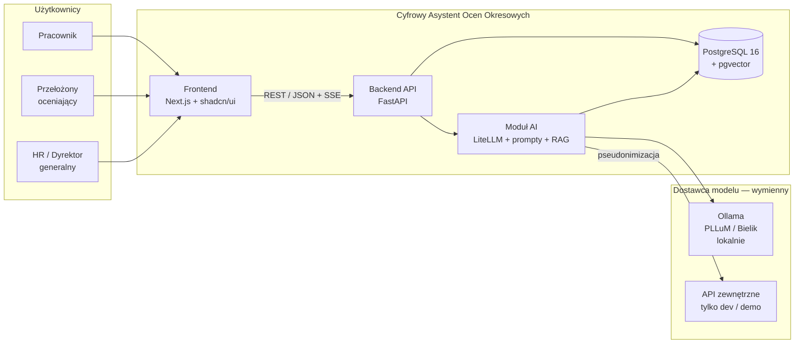
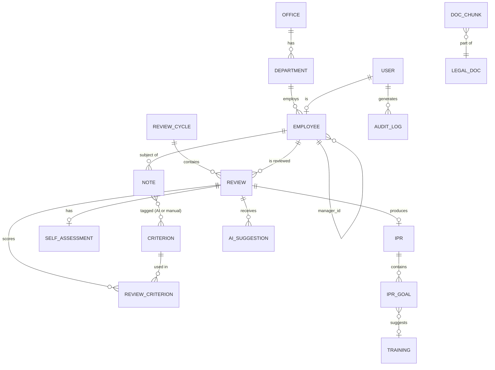
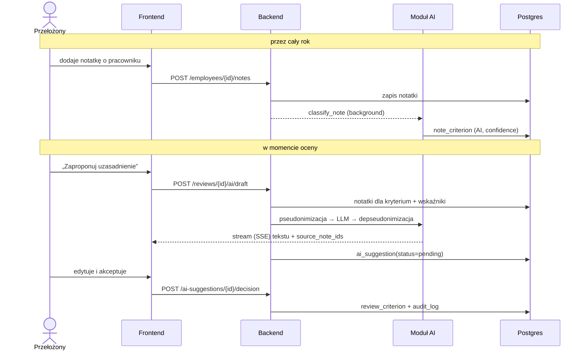

# Cyfrowy Asystent Ocen Okresowych — architektura

> Rozwiązanie na HackNation, wyzwanie KPRM / Służba Cywilna.
> Cel: zrobić z oceny okresowej narzędzie do rozwoju pracownika i zarządzania zespołem, a nie formularz do odhaczenia.
> System ma się dać uruchomić w każdym z ~1740 urzędów **lokalnie, bez chmury** (`docker compose up`).

---

## 1. Założenia projektowe

| # | Zasada | Co to znaczy w praktyce |
|---|--------|-------------------------|
| 1 | **Human-in-the-loop** | AI tylko proponuje. Każda sugestia ma status `accepted / edited / rejected`, a decyzję zawsze podejmuje człowiek. Ocena pracowników to obszar wysokiego ryzyka w AI Act. |
| 2 | **Suwerenność danych (RODO)** | Model językowy da się podmienić na lokalny (PLLuM / Bielik przez Ollama). Przy zewnętrznym API dane są pseudonimizowane przed wysłaniem. |
| 3 | **Kryteria jako dane, nie kod** | Kryteria oceny, skale i szablony arkusza są w bazie (seed z JSON). Zmiana rozporządzenia nie wymaga zmian w kodzie. |
| 4 | **Śledzalność** | Każde zdanie wygenerowanego uzasadnienia wskazuje notatki źródłowe (`source_note_ids`). Nie ma „halucynowanych” osiągnięć. |
| 5 | **Deterministycznie, gdzie się da** | Statystyki, efekt świeżości, zgodność ocena–tekst: kod + SQL. LLM tylko tam, gdzie potrzebny jest język. |
| 6 | **Jedna komenda** | `cp .env.example .env && docker compose up` daje działający system z danymi demo. |

---

## 2. Widok systemu (C4 — kontekst i kontenery)



### Kontenery (docker-compose)

| Serwis | Obraz | Port | Rola |
|--------|-------|------|------|
| `db` | `postgres:16-alpine` | 5432 | dane relacyjne + wektory do RAG w kolumnie JSON (ADR 0002) |
| `backend` | własny (Python 3.12) | 8000 | REST API, logika domenowa, moduł AI |
| `frontend` | własny (Node 22) | 3000 | UI |
| `ollama` | `ollama/ollama` | 11434 | lokalny LLM i embeddingi; **profil `local-llm`**, opcjonalny. Domyślnie backend używa Ollamy zainstalowanej na hoście (`host.docker.internal`, z GPU) |

```bash
docker compose up                         # model: Ollama na hoście (lub reguły, gdy jej brak)
docker compose --profile local-llm up     # Ollama w kontenerze (DOCKER_OLLAMA_BASE_URL=http://localhost:11434)
```

---

## 3. Struktura repozytorium

```
cyfrowy-asystent-ocen/
├── README.md                  # opis, screenshoty, jak uruchomić (1 komenda)
├── ARCHITECTURE.md            # ten plik
├── docker-compose.yml
├── .env.example
├── Makefile                   # make up / seed / test / lint / gen-client
├── .github/workflows/ci.yml   # lint + testy (z FakeLLM, bez kluczy API)
│
├── backend/
│   ├── pyproject.toml         # uv / poetry
│   ├── Dockerfile
│   ├── alembic/               # migracje
│   ├── app/
│   │   ├── main.py            # FastAPI app, routery, CORS
│   │   ├── config.py          # pydantic-settings (.env)
│   │   ├── db.py              # engine, sesja
│   │   ├── auth/              # JWT, role, zależności FastAPI
│   │   ├── models/            # SQLModel — tabele
│   │   ├── schemas/           # Pydantic DTO (wejście/wyjście API)
│   │   ├── api/               # routery: notes, reviews, ipr, analytics, ai
│   │   ├── services/          # logika domenowa (bez HTTP)
│   │   ├── ai/
│   │   │   ├── provider.py    # interfejs LLMProvider + LiteLLM + FakeLLM
│   │   │   ├── pseudonymizer.py
│   │   │   ├── prompts/       # szablony Jinja2 (.j2), wersjonowane
│   │   │   ├── rag/           # ingest, chunking, retrieval (pgvector)
│   │   │   └── pipelines/     # classify_note, draft_justification,
│   │   │                      # quality_check, generate_ipr, compare_self
│   │   └── analytics/         # czyste SQL / pandas — bez LLM
│   ├── seed/
│   │   ├── criteria.json      # kryteria i skala z rozporządzenia
│   │   ├── trainings.json     # katalog szkoleń (do IPR)
│   │   ├── legal/             # teksty przepisów do RAG (.md/.txt)
│   │   └── demo_data.py       # fikcyjny urząd, pracownicy, notatki
│   └── tests/
│
├── frontend/
│   ├── package.json
│   ├── Dockerfile
│   ├── src/
│   │   ├── app/               # Next.js App Router
│   │   │   ├── (auth)/login/
│   │   │   ├── notes/         # dziennik obserwacji
│   │   │   ├── reviews/[id]/  # arkusz oceny + panel AI
│   │   │   ├── self-assessment/
│   │   │   ├── ipr/[id]/
│   │   │   └── dashboard/     # HR / DG
│   │   ├── components/        # shadcn/ui + własne
│   │   └── lib/api/           # klient wygenerowany z OpenAPI
│   └── ...
│
└── docs/
    ├── pitch.pdf
    ├── screenshots/
    └── adr/                   # krótkie Architecture Decision Records
```

---

## 4. Role i uprawnienia

| Rola | Może |
|------|------|
| `employee` | zobaczyć swoje oceny i IPR, wypełnić samoocenę, dodać własne osiągnięcia do dziennika |
| `manager` | prowadzić dziennik obserwacji podwładnych, tworzyć i edytować ocenę, korzystać z asystenta AI, zatwierdzać IPR |
| `hr` | dashboard całego urzędu (zagregowany, bez treści notatek), zarządzanie kryteriami i katalogiem szkoleń |
| `admin` | użytkownicy, struktura organizacyjna |

Na hackathon wystarczy JWT + login hasłem i gotowe konta demo. W architekturze zostaw miejsce na **OIDC (Keycloak / SSO urzędu)**. Wystarczy jedna zależność w `auth/`.

Ograniczenia na poziomie danych: przełożony widzi tylko swoich podwładnych (`employee.manager_id`), a HR widzi tylko agregaty. To się sprawdza w `services/`, nie we frontendzie.

---

## 5. Model danych



### Kluczowe tabele

| Tabela | Najważniejsze pola |
|--------|--------------------|
| `employee` | `id, full_name, position, department_id, manager_id, position_description` |
| `criterion` | `id, code, name, description, is_mandatory, behavioral_indicators (JSON)` |
| `review_cycle` | `id, period_start, period_end, status` |
| `note` | `id, employee_id, author_id, date, text, sentiment, source (manager/self)` |
| `note_criterion` | `note_id, criterion_id, confidence, assigned_by (ai/human)` |
| `review` | `id, employee_id, reviewer_id, cycle_id, status (draft/submitted/discussed/final), overall_level` |
| `review_criterion` | `review_id, criterion_id, score, justification, source_note_ids[]` |
| `self_assessment` | `review_id, per-criterion score + comment (JSON)` |
| `ipr`, `ipr_goal` | cel rozwojowy, działanie, termin, powiązane kryterium, `training_id` |
| `ai_suggestion` | `id, review_id, kind, payload (JSON), model, prompt_version, status, created_at, decided_at` |
| `legal_doc`, `doc_chunk` | tekst, `embedding vector(1024)`, metadane (paragraf, źródło) |
| `audit_log` | kto, co, kiedy: dostęp do danych osobowych, decyzje dot. AI |

> Kryteria i skala pochodzą z **rozporządzenia PRM z 4 kwietnia 2016 r. (Dz.U. 2016 poz. 470)**: 14 kryteriów z załącznika nr 1, kryteria obowiązkowe dla arkuszy A, B i C (§ 4), skala 1/3/5/7/9 (§ 11). Są zapisane w `backend/seed/criteria.json`.

---

## 6. Moduł AI

### 6.1 Abstrakcja dostawcy

```python
class LLMProvider(Protocol):
    def complete_json(self, prompt: str, schema: type[BaseModel]) -> BaseModel: ...
    def stream(self, prompt: str) -> Iterator[str]: ...
    def embed(self, texts: list[str]) -> list[list[float]]: ...
```

Implementacje:
- `LiteLLMProvider`: jedna klasa obsługuje Ollamę (`ollama/...`), dowolne API i vLLM. Model wybiera się w `.env` (`LLM_MODEL=ollama/SpeakLeash/bielik-11b-v2.3-instruct`).
- `FakeLLMProvider`: deterministyczne odpowiedzi do testów i CI.

Wszystkie odpowiedzi są **strukturalne (JSON → Pydantic)**. Jeśli walidacja się nie powiedzie, następuje jedna ponowna próba z komunikatem błędu, a potem kontrolowany błąd w UI.

### 6.2 Pseudonimizacja

Znamy imiona i nazwiska z bazy, więc podmiana jest deterministyczna i nie wymaga NER-a:

```
"Anna Kowalska świetnie poprowadziła..." → "[OSOBA_1] świetnie poprowadziła..."
```

Mapowanie trzymamy w pamięci na czas jednego requestu i odwracamy w odpowiedzi. Dodatkowo regexy na PESEL, e-mail i telefon. Przy `LLM_MODE=local` pseudonimizacja może być wyłączona.

### 6.3 Pipeline'y

| Pipeline | Wejście | Wyjście | LLM? |
|----------|---------|---------|------|
| `classify_note` | notatka + lista kryteriów | `[{criterion_id, confidence}]`, sentyment | tak |
| `draft_justification` | notatki przypisane do kryterium + wskaźniki behawioralne | uzasadnienie + `source_note_ids` dla każdego zdania + proponowany poziom | tak |
| `quality_check` | gotowa ocena | lista ostrzeżeń (patrz niżej) | częściowo |
| `compare_self` | ocena przełożonego + samoocena | rozbieżności + proponowane pytania do rozmowy oceniającej | tak |
| `generate_ipr` | słabsze kryteria + opis stanowiska + RAG (katalog szkoleń) | cele SMART + działania + szkolenia | tak + RAG |
| `legal_qa` | pytanie przełożonego („czy muszę…?”) | odpowiedź z cytatem z przepisu | RAG |

### 6.4 Kontrola jakości oceny

| Sprawdzenie | Implementacja |
|-------------|---------------|
| Efekt świeżości: >X% notatek z ostatnich 2 mies. | **kod** (daty notatek) |
| Brak dowodów: kryterium ocenione bez notatek | **kod** |
| Niespójność: wysoki wynik vs negatywny tekst | kod (sentyment) + LLM |
| Ogólnikowość („pracuje dobrze”) | LLM |
| Język stronniczy: cechy osobowe zamiast zachowań, stereotypy płciowe | LLM + słownik |
| Efekt halo: wszystkie kryteria identyczne | **kod** |
| Rozkład ocen przełożonego vs średnia urzędu (łagodność/surowość) | **SQL** |

### 6.5 RAG

- Źródła: ustawa o służbie cywilnej (rozdział o ocenach), rozporządzenie w sprawie ocen okresowych, katalog szkoleń, opisy stanowisk.
- Chunking po jednostkach redakcyjnych (artykuł / paragraf / ustęp), w metadanych źródło do cytowania.
- Embeddingi: `bge-m3` lub `multilingual-e5-large` (oba działają z polskim, `bge-m3` jest dostępny w Ollamie).
- Wyszukiwanie: `pgvector` (cosine) + opcjonalnie pełnotekstowe `tsvector` (hybryda), top-k = 5.

### 6.6 Prompty

- Pliki `.j2` w `ai/prompts/`, każdy z wersją w nazwie (`draft_justification.v2.j2`).
- `prompt_version` i `model` zapisywane w `ai_suggestion`: wiadomo, co wygenerowało daną treść.

---

## 7. API (najważniejsze endpointy)

```
POST   /auth/login

GET    /employees?team=mine
GET    /employees/{id}

GET    /employees/{id}/notes
POST   /employees/{id}/notes                  → automatycznie classify_note (background)
PATCH  /notes/{id}/criteria                    # ręczna korekta tagów

POST   /reviews                                # utworzenie oceny w cyklu
GET    /reviews/{id}
PATCH  /reviews/{id}                           # zapis szkicu
POST   /reviews/{id}/submit
GET    /reviews/{id}/form.pdf                  # arkusz oceny A/B/C do pliku (reportlab)

POST   /reviews/{id}/ai/draft?criterion_id=    → SSE stream uzasadnienia
POST   /reviews/{id}/ai/quality-check
POST   /reviews/{id}/ai/compare-self
POST   /ai-suggestions/{id}/decision           # accepted / edited / rejected

PUT    /reviews/{id}/self-assessment

POST   /reviews/{id}/ipr/generate
GET    /ipr/{id}
PATCH  /ipr/{id}

POST   /assistant/legal-qa

GET    /analytics/distribution?department=
GET    /analytics/competency-gaps
GET    /analytics/reviewer-calibration
GET    /analytics/ai-adoption                  # % zaakceptowanych / edytowanych sugestii
```

Frontend korzysta z klienta TypeScript wygenerowanego z `/openapi.json` (`make gen-client`, `openapi-typescript`), więc typy są zawsze zgodne z backendem.

---

## 8. Kluczowe przepływy

### 8.1 Od notatki do uzasadnienia



### 8.2 Proces oceny okresowej

Etapy, pola arkusza i ich edytowalność odwzorowują przypadki użycia oraz „schemat pól formularza” KPRM (ADR 0004).

```mermaid
stateDiagram-v2
    [*] --> criteria: kadry wprowadzają pracownika albo sporządzono poprzednią ocenę (start automatyczny; kryteria 30 / 7 dni, § 7)
    criteria --> observation: rozmowa rozpoczynająca (§ 5) + potwierdzenie oceniającego i ocenianego
    observation --> draft: przygotowanie oceny (termin: 24 mies. + nieobecności > 1 mies.)
    draft --> submitted: kontrola jakości bez krytycznych braków
    submitted --> draft: korekta
    submitted --> discussed: rozmowa oceniająca (§ 10)
    discussed --> final: ocena na piśmie + wnioski do IPR + podpis oceniającego (§ 11); start kolejnego cyklu
    final --> acknowledged: zapoznanie ocenianego albo fikcja zapoznania
    acknowledged --> objection: sprzeciw w 7 dni (art. 83 ust. 1)
    objection --> acknowledged: sprzeciw nieuwzględniony
    objection --> acknowledged: zmiana oceny - wprowadza dyrektor generalny w formularzu
    objection --> draft: sporządzenie po raz drugi
    acknowledged --> [*]
```



Przebieg odwzorowuje schemat procesu KPRM (BPMN, tory: zarządzający, oceniający, oceniany, admin, scheduler): start cyklu po wprowadzeniu pracownika i po każdej sporządzonej ocenie (`services/cycle.py`), powiadomienia stron na każdym kroku, zmiana oceny po sprzeciwie wprowadzana przez dyrektora generalnego.

Terminy liczy `services/deadlines.py` (miesiące z końcem miesiąca, dni od zdarzenia, przesunięcie na dzień roboczy z polskimi świętami, łączenie nieobecności). Przypomnienia (`/reminders?scope=self|team|all`) to „scheduler” z przypadków użycia - liczony przy odczycie, gotowy do podpięcia pod cron i e-mail. `scope=self` (sprawy własne ocenianego) zasila widok `/me`, `scope=team` (zadania o zespole i sprawy kadrowe) - `/team` i dashboard.

## 9. Frontend — ekrany

| Ekran | Rola | Zawartość |
|-------|------|-----------|
| **Mój zespół** | manager | lista podwładnych, liczba notatek, status oceny, przypomnienia („brak notatek od 3 mies.”) |
| **Dziennik obserwacji** | manager / employee | szybkie dodawanie notatki (1 pole + data), tagi kryteriów od AI do poprawienia |
| **Arkusz oceny** | manager | kryteria po lewej, po prawej panel AI: szkic, dowody (klikalne notatki), ostrzeżenia jakości |
| **Samoocena** | employee | to samo, w uproszczeniu |
| **Przygotowanie do rozmowy** | manager | rozbieżności samoocena vs ocena + pytania |
| **IPR** | manager + employee | cele, działania, szkolenia, terminy |
| **Dashboard** | hr | rozkład ocen, kalibracja oceniających, luki kompetencyjne, adopcja AI |
| **Asystent przepisów** | wszyscy | czat z cytatami z rozporządzenia |

Biblioteki: shadcn/ui, TanStack Query, react-hook-form + zod, Recharts (dashboard).

---

## 10. Bezpieczeństwo i zgodność

- **RODO**: minimalizacja danych w promptach, pseudonimizacja, tryb w pełni lokalny, `audit_log` dostępu do danych osobowych, brak trenowania modeli na danych urzędu.
- **AI Act** (system wysokiego ryzyka, zatrudnienie): human oversight (sugestie wymagają decyzji), przejrzystość (oznaczenie treści AI w UI), logowanie (`ai_suggestion` z modelem i wersją promptu).
- **Dostęp**: autoryzacja w warstwie serwisów, HR widzi agregaty od N ≥ 5 osób (k-anonimowość na dashboardzie).
- **Sekrety**: tylko `.env`, w repo wyłącznie `.env.example`.
- **WCAG 2.1 AA**: administracja publiczna ma obowiązek dostępności, a shadcn/Radix daje dobrą bazę.

---

## 11. Uruchomienie

`.env.example`:

```dotenv
DATABASE_URL=postgresql+psycopg://app:app@db:5432/app
JWT_SECRET=change-me

# tryb: local (Ollama) | external | fake
LLM_MODE=local
LLM_MODEL=ollama_chat/hf.co/mradermacher/PLLuM-12B-instruct-2512-GGUF:Q4_K_M   # lub Bielik
LLM_API_KEY=
EMBEDDING_MODEL=ollama/bge-m3
OLLAMA_BASE_URL=http://localhost:11434

PSEUDONYMIZE=true
SEED_DEMO_DATA=true
```

Start backendu: `create_all` → seed (kryteria, przepisy do RAG, dane demo; brakujące embeddingi są uzupełniane) → `uvicorn`.

Konta demo (w README): każdy pracownik ma konto `imie.nazwisko@demo.gov.pl` (np. `marek.zielinski@demo.gov.pl`, `anna.kowalska@demo.gov.pl`), a dodatkowo `hr@demo.gov.pl` i `admin@demo.gov.pl`.

---

## 12. Testy i CI

- `pytest` + `FakeLLMProvider`: testy pipeline'ów bez kluczy API.
- Testy reguł deterministycznych (efekt świeżości, efekt halo) na danych syntetycznych.
- Kilka przykładów „golden” dla promptów (wejście → oczekiwane cechy wyjścia), uruchamianych ręcznie z prawdziwym modelem.
- GitHub Actions: `ruff`, `pytest`, `npm run lint && npm run build`.

---

## 13. Plan na hackathon

| Etap | Zakres | Priorytet |
|------|--------|-----------|
| 0 | szkielet repo, docker-compose, migracje, seed, logowanie | **musi** |
| 1 | dziennik notatek + `classify_note` | **musi** |
| 2 | arkusz oceny + `draft_justification` ze źródłami | **musi** (główne demo) |
| 3 | `quality_check` (najpierw reguły kodowe, potem LLM) | **musi** |
| 4 | `generate_ipr` | powinno |
| 5 | samoocena + `compare_self` | powinno |
| 6 | dashboard HR | powinno (dobrze wygląda na pitchu) |
| 7 | RAG + asystent przepisów | fajnie mieć |
| 8 | profil `local-llm` przetestowany na Bieliku/PLLuM | **na demo pokazać choć raz** |

Scenariusz demo (3 min): przełożony otwiera ocenę → AI składa uzasadnienie z rocznych notatek z klikalnymi dowodami → kontrola jakości wyłapuje efekt świeżości i ogólnik → generuje się IPR → dashboard HR pokazuje „łagodnego” oceniającego → przełączenie na lokalny model i informacja, że żadne dane nie opuściły serwera.

---

## 14. Stan implementacji i odstępstwa od planu

Zaimplementowane etapy 0–7 z sekcji 13. Odstępstwa od pierwotnego planu (uzasadnienia w `docs/adr/`):

| Plan | Implementacja | Powód |
|---|---|---|
| pgvector | embeddingi w kolumnie JSON + hybryda cosinus/leksykalna | mały korpus, ten sam kod na SQLite i Postgresie (ADR 0002) |
| Alembic | Alembic, migracje w `app/migrations`, `upgrade head` automatycznie przy starcie | aktualizacja w urzędzie bez utraty danych; baza z wersji MVP oznaczana jako wersja bazowa |
| SSE stream uzasadnienia | zwykły POST z gotowym JSON-em | odpowiedź strukturalna (zdania + `source_note_ids`) waliduje się w całości |
| klient TS z OpenAPI | ręcznie napisane typy w `frontend/src/lib/types.ts` | mniej narzędzi w buildzie; OpenAPI dostępne pod `/docs` |
| shadcn/ui, react-hook-form | własne komponenty na Tailwind (`components/ui.tsx`) | mniej zależności przy Next 16 / Tailwind 4 |
| — | tryb `fake` i fallback na heurystyki | system działa bez modelu, CI bez kluczy (ADR 0001) |
| — | Next.js rewrites `/api/*` → backend | brak CORS, jeden adres dla użytkownika |
| — | `/analytics/overview`, analiza średnich K/M | jeden request dla dashboardu; wykrywanie stronniczości |
| cykl draft→final | pełny proces z części I-III arkusza, zapoznaniem, fikcją zapoznania i sprzeciwem | dokumenty KPRM: przypadki użycia, schemat pól formularza (ADR 0004) |
| — | wirtualny HR partner: `analytics/wellbeing.py` (jawne reguły) + `conversation_prep` (LLM) | wymaganie modułu HR partnera z opisu wyzwania |
| — | wydruk arkusza `/reviews/{id}/print` wg wzoru, serwerowy PDF `/reviews/{id}/form.pdf` (reportlab, wzory zał. 2-4), zaproszenia `.ics` | „wydruk zgodny z wzorem”, integracja z pocztą |
| — | HR widzi sporządzone arkusze (final/acknowledged/objection), bez szkiców i notatek | komórka kadrowa prowadzi dokumentację i obsługuje sprzeciwy |
| — | panel Kadry (`/admin/*`): pracownicy, podległość = zmiana oceniającego, nieobecności przeliczające termin, ustanie zatrudnienia | przypadki użycia „ogólne” z materiałów KPRM |
| — | powiadomienia w systemie + SMTP, `python -m app.services.notify digest` z crona | „przypominać o terminach”, integracja z pocztą |
| — | wniosek ocenianego o zmianę terminu, tryb korekty administratora (`correction_reason`) | przypadki użycia KPRM |
| — | klikalny pasek etapów oceny: etapy przeszłe do wglądu (tylko odczyt), bieżący edytowalny, przyszłe zablokowane; pola etapu „Rozmowa oceniająca” (status `submitted`) odblokowuje zaproszenie `.ics` (`assessment_invited_at`) | schemat procesu KPRM: przełożony musi móc wrócić do wcześniejszych etapów, a rozmowę oceniającą trzeba najpierw umówić |
| instalator natywny dla Windows | kontenery OCI + `start.ps1` + `scripts/backup-postgres.ps1`; zmiany kryteriów migracją danych, nie seedem | licencja Dockera rozwiązywana Podmanem, a seed wypełnia tylko puste tabele (ADR 0005) |
