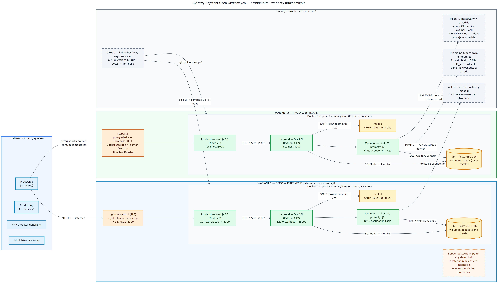
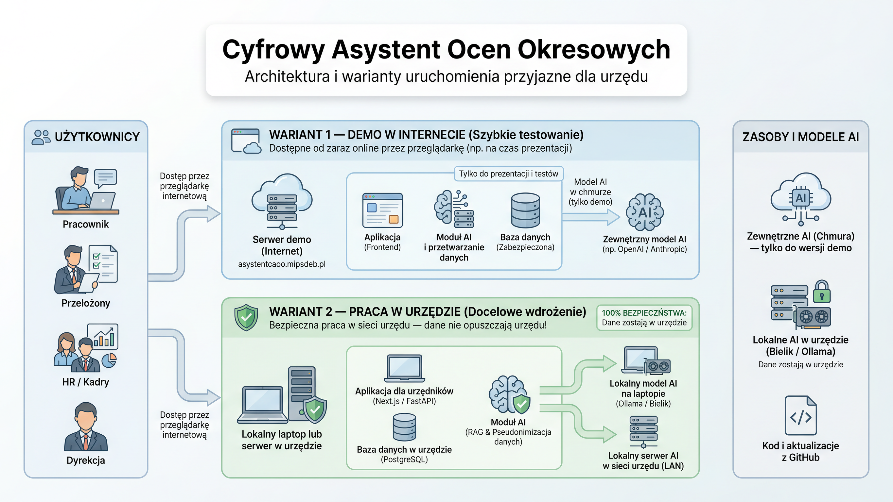

# Cyfrowy Asystent Ocen Okresowych

> HackNation 2026 · wyzwanie KPRM / Służba Cywilna
> **AI sugeruje, człowiek decyduje.** Ocena okresowa jako narzędzie rozwoju, a nie formularz do odhaczenia.

System prowadzi przełożonego i pracownika przez **cały proces oceny okresowej** zgodnie z **ustawą o służbie cywilnej (art. 81–83, 89)** i **rozporządzeniem Prezesa Rady Ministrów z 4 kwietnia 2016 r. (Dz.U. 2016 poz. 470)**: wybór arkusza A/B/C i kryteriów, rozmowa rozpoczynająca z potwierdzeniami obu stron, dziennik obserwacji przez cały okres oceny, arkusz z asystentem AI i kontrolą jakości, rozmowa oceniająca, podpisy i zapoznanie (również fikcja zapoznania), sprzeciw, wniosek o stopień służbowy, IPRZ i **wydruk arkusza zgodny ze wzorem**. Terminy liczy kod wg zasad KPRM (dni wolne, nieobecności). **Wirtualny HR partner** przygotowuje przełożonego do rozmów i podpowiada, kiedy wesprzeć lub docenić pracownika. Dyrektor generalny i HR dostają zagregowany obraz urzędu.

Całość działa **lokalnie, bez chmury**. Model językowy (Bielik / PLLuM przez Ollamę) uruchamia się na serwerze urzędu, więc dane osobowe go nie opuszczają.

## Co rozwiązujemy

| Problem dzisiejszych ocen | Co robi asystent |
|---|---|
| Ocena pisana z pamięci z ostatnich tygodni | **Dziennik obserwacji** przez cały okres. AI przypisuje notatki do kryteriów z rozporządzenia, a przełożony może je poprawić. System przypomina o pracownikach bez notatek od 3 miesięcy. |
| Ogólniki („pracuje dobrze”) | **Propozycja uzasadnienia** złożona z notatek. Każde zdanie wskazuje notatki źródłowe (klikalne `#id`), więc AI nie dopisuje osiągnięć, których nie było. |
| Efekt świeżości, efekt halo, stronniczy język | **Kontrola jakości**: reguły w kodzie (efekt świeżości, halo, brak dowodów, niespójność ocen z notatkami, skrajne oceny bez uzasadnienia) oraz słownik i LLM do ogólników i języka stronniczego (płeć, wiek, zdrowie, rodzina, osobowość zamiast zachowań). |
| Kryteria dobierane „z automatu”, a pracownik bierny w rozmowie rozpoczynającej | **Etap I z AI po obu stronach.** Przełożony dostaje propozycję kryteriów dodatkowych (maks. 3, § 5 ust. 2) z danych historycznych: opis stanowiska, słabsze wyniki z poprzedniej oceny, cele z IPRZ, kryteria wybierane dla tego samego stanowiska. Dowody liczy kod, model tylko uzasadnia, a decyzja trafia do dziennika zdarzeń. Pracownik dostaje własne przygotowanie do rozmowy: co znaczą kryteria i o co zapytać, jak przedstawić swoje cele, jak rzeczowo zgodzić się albo nie zgodzić z kryterium. Przełożony tego materiału nie widzi. |
| Rozmowa oceniająca jako formalność | **Porównanie z samooceną** i pytania do rozmowy (§ 10), zaczynając od największych rozbieżności. |
| IPRZ pisany „na odczepnego” | **Generator IPRZ**: cele, działania, mierniki i terminy dla słabszych kryteriów oraz szkolenia z katalogu urzędu. Po zatwierdzeniu wnioski trafiają do arkusza (§ 11 ust. 1 pkt 5). |
| „Wszyscy dostają bardzo dobry” | **Dashboard HR**: rozkład ocen w komórkach, kalibracja oceniających (łagodny / surowy), luki kompetencyjne, porównanie średnich K/M, adopcja AI. Tylko agregaty z k-anonimowością (grupy poniżej 5 osób są ukryte). |
| „Czy ja muszę…?” | **Asystent przepisów**: odpowiedzi z cytatem z ustawy i rozporządzenia (RAG). |
| Pilnowanie terminów i formalności | **Kalkulator terminów i przypomnienia**: 30/7 dni na kryteria, 24 miesiące na ocenę (przedłużenie o nieobecności > 1 mies.), 7 dni na sprzeciw, 14 dni na jego rozpatrzenie, ponowna ocena po 6 mies., obligatoryjny stopień w 30 dni. Blokady kroków, gdy brakuje wymaganych elementów. |
| Kadry i sytuacje kadrowe | **Panel Kadry** (wszystkie funkcje kadrowe z diagramu przypadków użycia KPRM): schemat urzędu (komórki), **zastępstwa przełożonych** (zastępca przejmuje zespół na czas nieobecności), **oceny historyczne** sprzed wdrożenia (od nich liczą się terminy, art. 71 i 89), **import z systemu kadrowego** (CSV z weryfikacją przed zapisem), **zestawienia** do archiwizacji/kontroli (CSV) i sprawozdawczości (JSON, k-anonimowość), historia ocen; dane pracowników i podstawa zatrudnienia (art. 81 ust. 1), wyszukiwanie i sortowanie, podległość służbowa (zmiana przełożonego przenosi trwającą ocenę do nowego oceniającego), nieobecności przeliczające termin oceny, ustanie zatrudnienia (oceny zostają w dokumentacji, robocze notatki są usuwane). Wniosek ocenianego o zmianę terminu, tryb korekty administratora. |
| Informacja do ludzi | **Powiadomienia** w systemie (dzwonek) i e-mailem (SMTP urzędu; w demo testowa skrzynka Mailpit pod http://localhost:8025, nic nie wychodzi do internetu). Codzienne przypomnienia o terminach: `python -m app.services.notify digest` z crona. |
| Papierowy arkusz | **Cyfrowy arkusz A/B/C** ze wszystkimi polami wzoru, potwierdzeniami obu stron i **wydrukiem / PDF zgodnym ze wzorem z rozporządzenia**. Zaproszenia na rozmowy w formacie `.ics` (Outlook, Thunderbird, Google). |
| Rozmowy, do których nikt nie uczy | **HR partner**: cel, przebieg, pytania, wskazówki komunikacyjne i trudne sytuacje dla rozmowy rozpoczynającej, bieżącej informacji zwrotnej i rozmowy oceniającej. |
| Przeciążenie i wypalenie widać za późno | **Sygnały dobrostanu** z dziennika (przeciążenie, spadek zaangażowania, zmiana trendu, powrót po nieobecności, brak informacji zwrotnej) z konkretnymi działaniami oraz **„warto docenić”**. Jawne reguły, widzi je tylko przełożony, nie wpływają na ocenę. |

## Zgodność z rozporządzeniem

To jest liczone w kodzie, nie przez LLM, i pokryte testami (`backend/tests/test_scoring.py`):

- 14 kryteriów z opisami z **załącznika nr 1**, arkusze **A, B i C** z kryteriami obowiązkowymi (§ 3–4), maksymalnie **3 kryteria dodatkowe** (§ 5 ust. 2),
- skala ocen cząstkowych **1 / 3 / 5 / 7 / 9 pkt** i progi ogólnego poziomu (§ 11 ust. 1 pkt 1–2),
- ocena negatywna przy średniej ≤ 4 **albo** przy choćby jednej ocenie cząstkowej „znacznie poniżej oczekiwań” (§ 11 ust. 1 pkt 4),
- obowiązkowe uzasadnienie oceny negatywnej (§ 11 ust. 3) i obowiązkowe wnioski do IPRZ przed zatwierdzeniem (§ 11 ust. 1 pkt 5),
- proces: **kryteria i rozmowa rozpoczynająca (§ 5, podpisy obu stron) → okres oceny → przygotowanie → rozmowa oceniająca (§ 10) → ocena na piśmie (§ 11) → zapoznanie lub fikcja zapoznania → sprzeciw (art. 83)**; pola arkusza są edytowalne tylko na etapach wskazanych w „schemacie pól formularza” KPRM,
- część III arkusza: wniosek o kolejny stopień służbowy tylko dla urzędnika z oceną pozytywną (art. 89 ust. 1), z obowiązkowym umotywowaniem; przypomnienie o stopniu obligatoryjnym (art. 89 ust. 2),
- terminy wg zasad obliczania terminów KPRM (`backend/app/services/deadlines.py`, testy na przykładach z materiału).

Kryteria są danymi, a nie kodem (`backend/seed/criteria.json`), a terminy (24 miesiące, 7 dni itd.) są w jednym słowniku `RULES`. Zmiana przepisów (np. częstotliwości ocen) to zmiana konfiguracji, a nie przebudowa systemu.

### Podstawy prawne i zakres

Zweryfikowane z materiałami KPRM: **rozporządzenie PRM z 4.04.2016 (Dz.U. 2016 poz. 470)** w całości (§ 1–13, załącznik nr 1 porównany automatycznie słowo w słowo, objaśnienia wzorów arkuszy A, B, C), **ustawa o służbie cywilnej** (art. 37–38, 52, 71, 81–84, 89, 108–109) i **Standardy ZZL** (zarządzenie nr 6 Szefa Służby Cywilnej z 12.03.2020). Fragmenty przepisów w asystencie pochodzą dosłownie z tych aktów (`backend/seed/legal`).

W systemie zaimplementowane m.in.: termin kryteriów 30/7 dni (§ 7), zmiana stanowiska (§ 9, art. 81 ust. 6), „okres od–do” wg objaśnień do arkusza, ostrzeżenie o drugiej z rzędu ocenie negatywnej urzędnika (art. 71 ust. 1 pkt 1), IPRZ: ustala przełożony → akceptuje kierujący komórką → zatwierdza dyrektor generalny (art. 108 ust. 2), brak IPRZ dla wyższych stanowisk (art. 52), informacja zwrotna bieżąca i cykliczna, wprowadzenie nowego pracownika, ocena na wniosek odchodzącego pracownika (Standardy ZZL).

**Poza zakresem:** *pierwsza ocena w służbie cywilnej* (art. 37–38, pracownicy na umowie na czas określony) - odrębny tryb i wzór arkusza z innego rozporządzenia, którego nie ma w materiałach wyzwania; nabór, wynagrodzenia, nagrody i postępowanie dyscyplinarne.

## Uruchomienie

### Docker (jedna komenda)

```bash
cp .env.example .env
docker compose up --build        # backend + frontend + Postgres
```

Frontend: http://localhost:3000 · API i dokumentacja OpenAPI: http://localhost:8000/docs · testowa skrzynka e-mail (Mailpit): http://localhost:8025

**Windows 11:** zamiast powyższych komend uruchom `.\start.ps1` (sprawdza Dockera, tworzy `.env`, podnosi stos, czeka na `/health` i otwiera przeglądarkę). Wymaga Docker Desktop albo — ze względu na licencję w administracji publicznej — Podman Desktop / Rancher Desktop.

Bez modelu system działa na regułach i heurystykach (UI to pokazuje). Żeby włączyć model lokalny:

**Wariant A: Ollama na hoście (Windows/macOS, korzysta z GPU).** Zainstaluj [Ollamę](https://ollama.com) i pobierz modele. Backend w kontenerze łączy się z nią przez `host.docker.internal`.

```bash
ollama pull hf.co/mradermacher/PLLuM-12B-instruct-2512-GGUF:Q4_K_M   # PLLuM 12B (Apache 2.0)
ollama pull bge-m3                                                    # embeddingi do RAG
```

**Wariant B: Ollama w kontenerze (serwer Linux).** W `.env` ustaw `DOCKER_OLLAMA_BASE_URL=http://ollama:11434` i uruchom:

```bash
docker compose --profile local-llm up --build
docker compose exec ollama ollama pull hf.co/mradermacher/PLLuM-12B-instruct-2512-GGUF:Q4_K_M
docker compose exec ollama ollama pull bge-m3
```

Model zmienia się jedną linijką `LLM_MODEL` w `.env`, na przykład na Bielika (`ollama_chat/SpeakLeash/bielik-11b-v2.3-instruct:Q4_K_M`). Embeddingi przepisów liczą się same przy starcie, gdy model `bge-m3` jest dostępny.

### Bez Dockera (development)

```bash
# backend - Python 3.12+, baza SQLite tworzy się sama z danymi demo
cd backend
python -m venv .venv
.venv/Scripts/python -m pip install -e ".[dev]"     # Linux/macOS: .venv/bin/python
.venv/Scripts/python -m uvicorn app.main:app --reload

# frontend - Node 20+
cd frontend
npm install
npm run dev
```

Model lokalny: jak w wariancie A powyżej. Backend czyta `.env` z katalogu głównego repo.

### Konta demo (hasło `demo123`)

Każdy pracownik w danych demo ma własne konto — login to służbowy adres w formacie
`imie.nazwisko@demo.gov.pl` (np. `anna.kowalska@demo.gov.pl`). W urzędzie format adresu może być inny;
administrator lub HR ustawia go w polu **E-mail** przy dodawaniu i edycji pracownika.

| Rola | E-mail | Co zobaczysz |
|---|---|---|
| Przełożony | `marek.zielinski@demo.gov.pl` | Marek Zieliński, Wydział Cyfryzacji: każdy etap procesu na innej osobie, przypomnienia, asystent AI, HR partner, IPRZ |
| Pracownik | `anna.kowalska@demo.gov.pl` | Anna Kowalska: samoocena, potwierdzenia, zapoznanie z oceną, sprzeciw, wniosek o zmianę terminu, IPRZ |
| HR | `hr@demo.gov.pl` | Kadry (pracownicy, schemat urzędu, zastępstwa, import, zestawienia), sprzeciwy, zatwierdzanie IPRZ, dashboard |
| Dyrektor generalny | `waclaw.zawadzki@demo.gov.pl` | Wacław Zawadzki: przełożony naczelników wydziałów - ocenia ich (arkusz B); na `/me` widzi własną ocenę okresową |
| Administrator | `admin@demo.gov.pl` | konta użytkowników i **tryb korekty błędów** w arkuszach (z powodem i historią) - wg schematu procesu KPRM; bez wglądu w dziennik obserwacji, samoocenę i szkice ocen, nie działa jako oceniający |
| Przełożona | `ewa.dabrowska@demo.gov.pl` | Ewa Dąbrowska: „łagodna” oceniająca na dashboardzie; po wprowadzeniu zastępstwa przejmuje zespół Marka |
| Przełożony | `andrzej.krawczyk@demo.gov.pl` | Andrzej Krawczyk: „surowy” oceniający, wydział z ocenami negatywnymi |

Etapy w danych demo (zespół kierownika): **Jakub** - wyznaczenie kryteriów (nowa umowa), **Tomasz** - okres oceny z terminem przesuniętym o nieobecność, **Magdalena** - okres oceny, „warto docenić”, **Anna** i **Piotr** - przygotowanie oceny, **Katarzyna** - brak arkusza i sygnały przeciążenia.

Wszystkie osoby i zdarzenia w danych demo są fikcyjne.

## Scenariusz demo (3 min)

0. **Przełożony → Mój zespół: przypomnienia** (termin kryteriów Jakuba, zbliżające się terminy ocen) i kolumna **HR partner** (Katarzyna: „wymaga rozmowy”). Jakub → część I arkusza: kryteria dodatkowe, data rozmowy, zaproszenie `.ics`, „Przygotuj mnie do rozmowy rozpoczynającej”, potwierdzenie.

1. **Przełożony → Mój zespół.** Przypomnienia o pracownikach bez notatek. Wejdź w *Anna Kowalska*, dodaj obserwację, a AI przypisze kryteria.
2. **Arkusz oceny Anny → „Zaproponuj uzasadnienie”** przy *Komunikacji*. Propozycja z klikalnymi źródłami `#id` obejmuje cały okres (od 2025 r.) razem z obszarami do poprawy. Ocenę cząstkową wystawia człowiek. Akceptuj, edytuj albo odrzuć.
3. **Arkusz oceny Piotra → „Sprawdź jakość oceny”.** Wykrywa efekt świeżości (86% notatek z ostatnich 2 miesięcy), efekt halo (same 9), ogólniki („pracuje dobrze, bez zastrzeżeń”) i język stronniczy („sympatyczny i młody”).
4. **Anna → zakładka „Rozmowa”.** Porównanie z samooceną (Komunikacja: 5 vs 9) i pytania do rozmowy oceniającej.
5. **„Zaproponuj IPR”.** Cele SMART ze szkoleniami z katalogu. Po zatwierdzeniu wnioski trafiają do arkusza.
6. **HR → Dashboard.** Kierownik Wydziału Obsługi Klienta jest oznaczony jako „łagodny” (+2 pkt od średniej), a jego wydział jako „inflacja ocen”. Widać też luki kompetencyjne urzędu.
7. **Baner w nagłówku:** „Model lokalny · dane nie opuszczają serwera urzędu”.

## Architektura w skrócie

### Diagram architektury

Dwa warianty uruchomienia: **demo w internecie** na serwerze (nginx + certbot, publiczny adres) oraz **praca w urzędzie** na Windows 11 z modelem AI hostowanym lokalnie.



Poglądowe przedstawienie systemu (użytkownicy, komponenty, przepływ danych):



### W skrócie

```
frontend (Next.js 16, Tailwind, TanStack Query, Recharts)
   │  /api/* (rewrite, bez CORS)
backend (FastAPI, SQLModel) ── PostgreSQL 16 / SQLite
   │
moduł AI: LiteLLM → Ollama (Bielik / PLLuM) | zewnętrzne API (z pseudonimizacją) | tryb fake (reguły)
   ├─ pipeline'y: classify_note, draft_justification, quality_check, compare_self, generate_ipr, legal_qa
   ├─ prompty .j2 wersjonowane; model + wersja promptu zapisywane przy każdej propozycji
   └─ RAG: rozporządzenie podzielone po jednostkach redakcyjnych, embeddingi bge-m3 + wyszukiwanie leksykalne
```

Szczegóły: [ARCHITECTURE.md](ARCHITECTURE.md) oraz decyzje w [docs/adr](docs/adr).

## Aktualizacja w urzędzie

Nowa wersja to nowy obraz Dockera. Przy starcie backend sam wykonuje migracje bazy (Alembic, `backend/app/migrations`), więc dane zostają. Bez Dockera: `git pull`, `pip install -e .`, restart. Nową migrację po zmianie modelu tworzy `python -m app.db revision "opis"`.

Kolejność w urzędzie:

```powershell
.\scripts\backup-postgres.ps1                  # 1. kopia bazy + .env + metadane (wersja, rewizja Alembica)
docker compose up -d --build                   # 2. nowy obraz; migracje wykonają się przy starcie
.\scripts\backup-postgres.ps1 -Restore backup\app_20261121_180000.dump   # 3. w razie problemu: powrót do kopii
```

Zasady: **nigdy `docker compose down -v`** (flaga `-v` usuwa wolumen `pgdata`, czyli bazę); rollback robi się odtworzeniem kopii, nie `alembic downgrade`; zmiany kryteriów i szkoleń z `seed/*.json` trafiają do działającej bazy migracją danych (wzorzec: `0009_upsert_kryteria`), bo seed wypełnia tylko puste tabele; po zmianie `EMBEDDING_MODEL` trzeba przeliczyć embeddingi przepisów. Szczegóły i lista rzeczy do dokończenia: [ADR 0005](docs/adr/0005-pakowanie-windows-i-migracje.md).

## Bezpieczeństwo, RODO, AI Act

- **Human-in-the-loop:** każda propozycja AI ma status `pending → accepted / edited / rejected`. AI nigdy nie wystawia ocen cząstkowych. Każda decyzja trafia do `audit_log`.
- **Przejrzystość:** treści AI są oznaczone w UI razem z nazwą modelu. Jeśli model był niedostępny i zadziałały reguły, UI też to pokazuje.
- **Śledzalność:** zdania uzasadnienia wskazują notatki źródłowe, a identyfikatory spoza przekazanych notatek są odrzucane w kodzie.
- **Suwerenność danych:** tryb `local` (Ollama) jest domyślny. W trybie `external` imiona i nazwiska (z odmianą), PESEL, e-mail i telefon są zastępowane tokenami przed wysłaniem.
- **Dostęp:** przełożony widzi tylko bezpośrednich podwładnych, HR widzi wyłącznie agregaty z k-anonimowością, a administrator tylko arkusze w trybie korekty błędów (bez dziennika, samooceny i szkiców ocen). Notatki naczelnika są domyślnie niejawne - pracownik widzi własne wpisy oraz notatki przełożonego, które ten udostępnił mu wprost (przycisk „Udostępnij podwładnemu”). Autoryzację sprawdza backend.
- **Dostępność:** semantyczny HTML, `aria-*`, widoczny focus, etykiety pól (WCAG 2.1 AA jako cel).

## Testy

```bash
cd backend && LLM_MODE=fake pytest -q   # 74 testy, bez modelu i bez kluczy API
cd frontend && npm run lint && npm run build
```

Testy obejmują skalę i progi z rozporządzenia, liczenie terminów (przykłady z materiału KPRM), etapy procesu i blokady pól, zapoznanie, sprzeciw, sygnały HR partnera, reguły jakości, pseudonimizację, kontrolę dostępu, pełny cykl oceny, k-anonimowość dashboardu i cytowanie przepisów. GitHub Actions uruchamia je przy każdym pushu.

## Licencja i źródła

Kod: MIT. Tekst rozporządzenia (Dz.U. 2016 poz. 470) jest aktem normatywnym i nie podlega prawu autorskiemu (art. 4 ustawy o prawie autorskim). Przed wdrożeniem zweryfikuj aktualny stan prawny w ISAP.
